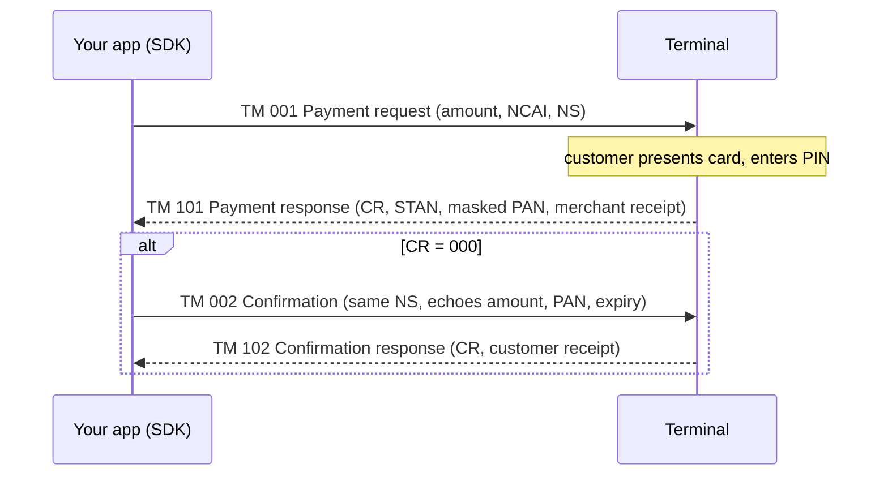

# TKpay NAPS POS SDK — Android (Kotlin)

Kotlin library that lets an Android point-of-sale app drive a NAPS Pay payment terminal:
take a card payment, void it, reprint receipts, run end-of-day settlement and maintenance
commands. It speaks the NAPS Pay ECR TLV protocol (spec v2.0, NapsPay v5.4.4) and turns the
terminal's replies into plain Kotlin results.

> Part of the NAPS SDK family. The **[C# SDK](https://github.com/Belkouche/tkpay-sdk-pos-naps-csharp)
> is the reference implementation**; this is the Android port. Test without hardware using the
> [emulator](https://github.com/Belkouche/tkpay-naps-emulator).

**Terminals and connections**

| Terminal (spec §2) | Connection | Supported by this SDK |
|---|---|---|
| Sunmi P2, Sunmi P3, Sunmi P2 Smart PAD | Wi-Fi, TCP port 4444 | **Yes** — default transport, tested against the emulator |
| Sunmi P2 / P3 / P2 Smart PAD | USB | No |
| Ingenico Self 5000, Ingenico Lane 3600 | USB only | **Implemented, not verified on hardware** — `TransportType.USB_SERIAL` (Android USB-host, CDC-ACM, Ingenico vendor id `0x0B00`) |

Requirements: Android 5.0+ (API 21), Kotlin 1.9+, coroutines. All SDK calls are `suspend`
functions; they switch to `Dispatchers.IO` themselves.

---

## Contents

1. [Install](#install)
2. [Quickstart](#quickstart)
3. [How a payment works](#how-a-payment-works)
4. [How a void works](#how-a-void-works)
5. [Other operations](#other-operations)
6. [Receipts](#receipts)
7. [PAN masking and data sent by the SDK](#pan-masking-and-data-sent-by-the-sdk)
8. [Response codes](#response-codes)
9. [Errors and timeouts](#errors-and-timeouts)
10. [Configuration](#configuration)
11. [Testing with the emulator](#testing-with-the-emulator)
12. [Troubleshooting](#troubleshooting)
13. [Changelog](#changelog)

---

## Install

**JitPack**

```gradle
// settings.gradle (root)
dependencyResolutionManagement {
    repositories {
        maven { url 'https://jitpack.io' }
    }
}
```

```gradle
// app/build.gradle — TAG is a release tag of this repo
dependencies {
    implementation 'com.github.Belkouche:tkpay-sdk-pos-android:TAG'
}
```

`v1.3.0` is the latest published tag. Version 1.4.0 (this README, NapsPay v5.4.4) is not
tagged yet. Until it is, use the local module below.

**Local module**

```bash
git clone https://github.com/Belkouche/tkpay-sdk-pos-android.git
```

```gradle
// settings.gradle
include ':naps-sdk'
project(':naps-sdk').projectDir = new File('../tkpay-sdk-pos-android/naps-sdk')

// app/build.gradle
dependencies {
    implementation project(':naps-sdk')
}
```

**Permissions.** The SDK's manifest declares `INTERNET`, `ACCESS_NETWORK_STATE` and the
optional `android.hardware.usb.host` feature. They are merged into your app automatically.

---

## Quickstart

Start the emulator (see [Testing with the emulator](#testing-with-the-emulator)), then:

```kotlin
import kotlinx.coroutines.runBlocking
import ma.tkpay.naps.NapsPayClient
import ma.tkpay.naps.config.NapsConfig
import ma.tkpay.naps.models.PaymentRequest

fun main() = runBlocking {
    val port = System.getenv("NAPS_PORT")?.toInt() ?: 4444
    val client = NapsPayClient(NapsConfig(host = "127.0.0.1", port = port))

    val result = client.processPayment(
        PaymentRequest(amount = 10.00, registerId = "01", cashierId = "00001")
    )

    if (result.isApproved()) {
        println("Approved — STAN ${result.stan}, card ${result.getFormattedCardNumber()}")
        println(result.customerReceipt?.toPlainText())
    } else {
        println("Declined [${result.responseCode}]: ${result.error}")
    }
}
```

This is [`examples/quickstart/Quickstart.kt`](examples/quickstart/Quickstart.kt). The repo
runs it against the emulator with
`NAPS_PORT=4444 ./gradlew :naps-sdk:testDebugUnitTest --tests '*QuickstartExampleTest' --rerun -i`.
Output:

```
Approved — STAN 903125, card 516794******3315
TKpay
--------------------------------
06/11/2026 23:41:32
TKPAY DEMO
CASABLANCA
...
MONTANT: 10.00 MAD
--------------------------------
DEBIT
Copie Client
```

In an Android app, use the terminal's Wi-Fi IP as `host` and call the client from a coroutine
(for example `lifecycleScope.launch { ... }`) instead of `runBlocking`.

`registerId` (2 digits) and `cashierId` (5 digits) identify your till and cashier; together
they form the NCAI field the terminal echoes back.

---

## How a payment works

A payment is two request/response pairs on **one TCP connection**. `processPayment` runs both
and closes the connection.



1. **TM 001 → 101.** The SDK sends the amount in centimes, the NCAI and a sequence number
   (NS, generated unless you set `PaymentRequest.sequence`). The terminal answers only after
   the customer has acted, so this read waits up to `timeout` (default 2 minutes). If CR ≠ 000,
   the payment is declined and there is no Phase 2.
2. **TM 002 → 102.** On the same connection, the SDK confirms with the same NS. It echoes
   the amount, the masked PAN and the card expiry from TM 101, so the terminal can check it is
   confirming the right sale. The reply must arrive within `confirmationTimeout` (default 40 s).
   **Only TM 102 with CR = 000 is an approved payment.** If the terminal refuses the
   confirmation (e.g. 302, 482), it reverses the sale itself and the SDK returns a failed result.

The merchant receipt comes from TM 101 and the customer receipt from TM 102.

### Process a payment

```kotlin
val amount = 150.00
try {
    val result = client.processPayment(
        PaymentRequest(amount = amount, registerId = "01", cashierId = "00001")
    )
    if (result.isApproved()) {
        // Keep these three values: a void needs them
        val stan = result.stan!!
        val sequence = result.sequence!!
        val amountCentimes = TlvProtocol.toCentimes(amount)   // 15000
        result.merchantReceipt?.let { printReceipt(it) }
        result.customerReceipt?.let { printReceipt(it) }
    } else {
        // Declined by the card network, the issuer or the terminal
        println("Declined [${result.responseCode}]: ${result.error}")
        result.merchantReceipt?.let { printReceipt(it) }   // decline ticket, if any
    }
} catch (e: NapsError) {
    // No usable answer from the terminal
    when (e.code) {
        ErrorCode.CONNECTION_FAILED -> println("Terminal unreachable: ${e.message}")
        ErrorCode.TIMEOUT -> println("Terminal did not answer in time")
        else -> println("Protocol error: ${e.message}")
    }
}
```

(`printReceipt` is your own function: see [Receipts](#receipts).)

**`PaymentResult` fields**

| Field | Description |
|---|---|
| `success`, `responseCode` | `isApproved()` = `success && responseCode == "000"` |
| `stan` | System Trace Audit Number — needed to void or reprint |
| `sequence` | NS used — needed to void |
| `maskedCardNumber` | e.g. `516794******3315` (also kept on declines) |
| `cardExpiry` | `YYMM`; `getFormattedExpiry()` gives `MM/YY` |
| `cardholderName`, `entryMode`, `authNumber`, `ncai` | As returned by the terminal |
| `transactionDate`, `transactionTime` | `DDMMYYYY`, `HHMMSS` |
| `merchantReceipt`, `customerReceipt` | `Receipt?` |
| `error` | Human-readable reason when not approved |

---

## How a void works

A void (cancellation) is also two phases on one connection. `cancelPayment` runs both.

```mermaid
sequenceDiagram
    participant App as Your app (SDK)
    participant T as Terminal
    App->>T: TM 003 Cancellation (STAN, amount, sequence)
    T-->>App: TM 103 (CR 000 = transaction found; amount, merchant receipt)
    App->>T: TM 004 Cancellation confirmation (same sequence in NS, amount from TM 103)
    Note over T: reversal executed here
    T-->>App: TM 104 (CR = final outcome)
```

TM 103 with CR = 000 only means **the transaction was found**. The reversal happens on TM 004,
so only TM 104 tells you whether it worked. The SDK maps the outcome as follows:

| Outcome | When | `success` | `pending` |
|---|---|---|---|
| **Success** | TM 104 CR = `000` or `480` | `true` | `false` |
| **Pending** | TM 104 CR = `995`, **or no TM 104 at all** (timeout or connection lost after TM 004) | `false` | `true` |
| **Failure** | TM 103 CR ≠ 000 (e.g. 302 not found, 482 already cancelled), or any other TM 104 CR | `false` | `false` |

**Pending means the reversal may or may not have run.** CR 995 is "Server processing error" in
the spec, but has been seen on voids that did go through on a live v5.4.4 terminal. A pending
result keeps the STAN of the transaction and the TM 103 merchant receipt. Never record it as
voided. Reprint the receipt for that STAN with `printDuplicate` and check it first.

You need the `stan` and `sequence` from the approved `PaymentResult`, and the amount in
centimes (required by NapsPay v5.4.4+):

```kotlin
val void = client.cancelPayment(
    stan = stan,
    registerId = "01",
    cashierId = "00001",
    sequence = sequence,
    amountCentimes = amountCentimes
)
when {
    void.success -> {
        println("Voided (CR ${void.responseCode}), STAN ${void.stan}")
        void.merchantReceipt?.let { printReceipt(it) }
    }
    void.pending -> {
        // Outcome unknown: the reversal may or may not have run.
        // Do NOT mark the sale as voided. Reprint the receipt for this STAN
        // and check it before doing anything else.
        println("Void unconfirmed (CR '${void.responseCode}'), checking STAN ${void.stan}")
        val dup = client.printDuplicate("01", "00001", stan = void.stan)
        dup.merchantReceipt?.let { printReceipt(it) }
    }
    else -> println("Void refused [${void.responseCode}]: ${void.error}")
}
```

`cancelPayment` never throws. Errors before TM 004 is sent come back as a failure with
`responseCode = ""` and the exception message in `error`.

---

## Other operations

All of these open a connection, send one request, read one reply and close. None of them
throws: on any error they return `success = false` with `error` set.

**Connection test** — opens a TCP socket only, no protocol message:

```kotlin
val reachable: Boolean = client.testConnection()
```

**Network test (TM 009)** — checks the whole till → terminal → NAPS server chain:

```kotlin
val net = client.networkTest("01", "00001")
println(if (net.success) "Network OK (${net.rttMs} ms)" else "Network test failed: ${net.error}")
```

**Referencing (TM 013)** — loads the terminal's parameter set. Run it once before the first
payment on a new terminal. `tide` picks the set: `"01"` merchant (default) or `"02"` recharge.

```kotlin
val ref = client.referencing("01", "00001")                      // merchant set "01"
val recharge = client.referencing("01", "00001", TlvProtocol.Tide.RECHARGE)
if (ref.success) ref.receipt?.let { printReceipt(it) }
```

**Duplicate receipt (TM 008)** — reprints the last transaction, or a given STAN:

```kotlin
val dup = client.printDuplicate("01", "00001")                   // last transaction
dup.merchantReceipt?.let { printReceipt(it) }
```

**Totals (TM 010)** — running batch totals, returned as a receipt:

```kotlin
val totals = client.totals("01", "00001")
totals.receipt?.let { printReceipt(it) }
```

**Settlement (TM 010)** — end-of-day batch transfer. The terminal must be idle.

```kotlin
val settlement = client.settlement("01", "00001")
println(if (settlement.success) "Settled ${settlement.date} ${settlement.time}" else "Settlement failed: ${settlement.error}")
```

**Reset PIN pad (TM 012)**:

```kotlin
val reset = client.resetPinPad("01", "00001")
println(if (reset.success) "PIN pad reset" else "Reset failed: ${reset.error}")
```

| Method | TM | Returns |
|---|---|---|
| `processPayment(request)` | 001 → 002 | `PaymentResult` (throws `NapsError`) |
| `cancelPayment(stan, registerId, cashierId, sequence, amountCentimes?)` | 003 → 004 | `CancellationResult` |
| `printDuplicate(registerId, cashierId, stan?)` | 008 | `DuplicateReceiptResult` |
| `networkTest(registerId, cashierId)` | 009 | `NetworkTestResult` |
| `totals(registerId, cashierId)` | 010 | `TotalsResult` |
| `settlement(registerId, cashierId)` | 010 | `SettlementResult` |
| `resetPinPad(registerId, cashierId)` | 012 | `ResetResult` |
| `referencing(registerId, cashierId, tide = "01")` | 013 | `ReferencingResult` |
| `testConnection()` | — | `Boolean` |

---

## Receipts

The terminal sends receipts in the DP field (tag 010) as print lines. Each line has a number,
a style (`S` simple / `G` bold) and an alignment (`G` left / `C` centre / `D` right). Lines are
separated by `*` and the block ends with `?` (spec §5). The SDK parses this into a `Receipt`:

```kotlin
println(receipt.toPlainText())        // one line per print line
println(receipt.toFormattedText())    // e.g. "[B][C]TKpay" = bold, centred

for (line in receipt.lines) {
    val align = when (line.alignment) {
        Alignment.LEFT -> "L"
        Alignment.CENTER -> "C"
        Alignment.RIGHT -> "R"
    }
    println("$align ${if (line.bold) "B" else "-"} ${line.text}")
}
```

Send each `line.text` to your printer with its `bold` and `alignment`. Terminal receipts are
formatted for narrow (58 mm) paper. The first centred line containing "Naps" is replaced by a
bold "TKPAY" line followed by "Powered by NAPS".

Where receipts appear: `PaymentResult.merchantReceipt` / `customerReceipt`,
`CancellationResult.merchantReceipt` (TM 103), `DuplicateReceiptResult.merchantReceipt`,
`TotalsResult.receipt`, `ReferencingResult.receipt`.

---

## PAN masking and data sent by the SDK

- **PAN masking.** The card number (tag 007) is masked as soon as a reply is parsed, keeping the
  first 6 and last 4 digits: `5167940123453315` → `516794******3315`. Any 16-digit number inside
  receipt text is masked the same way. The full PAN is never returned by the SDK.
- **No storage.** The SDK has no code that writes to disk or `SharedPreferences`. Its log lines
  contain no card data.
- **Gateway notification.** After every `processPayment` call (approved or declined), the SDK
  sends a background `POST` to `https://api.tkpay.ma/v1/transactions/notify`. It contains the
  amount, response code, STAN, authorization number, masked card number, expiry, entry mode,
  cardholder name, NCAI, register and cashier ids, sequence, transaction date and time, success
  flag, error message, SDK version and platform. The endpoint is fixed. A failure never affects
  the payment result. The other operations send nothing.

---

## Response codes

Every reply carries a response code (CR, tag 013). `000` means success. The approval set is
`000`, `001`, `003`, `007`. The full table from spec §6 is in
[`TlvProtocol.RESPONSE_CODES`](naps-sdk/src/main/java/ma/tkpay/naps/protocol/TlvProtocol.kt):

```kotlin
TlvProtocol.describeResponse("116")   // "Insufficient funds"
TlvProtocol.isApproved("000")         // true (approval set: 000, 001, 003, 007)
TlvProtocol.RESPONSE_CODES            // the full table, Map<String, String>
```

Common ones: `100` do not honour, `116` insufficient funds, `117` incorrect PIN, `302` record
not found, `307` format error, `480` reversal accepted, `482` already cancelled, `909` system
failure, `995` server processing error.

---

## Errors and timeouts

**Who throws.** Only `processPayment` throws a `NapsError` (`e.code` is an `ErrorCode`), when
it gets no usable reply:

| `ErrorCode` | Cause |
|---|---|
| `CONNECTION_FAILED` | Socket could not be opened or broke; no host for TCP; USB permission denied |
| `TIMEOUT` | No reply within the timeout for that step |
| `INVALID_RESPONSE` | Empty reply, connection closed before a reply, missing CR / STAN / NS, or a reply over 64 KB without a terminator |

A *declined* payment is not an exception: it is a `PaymentResult` with `success = false`.
Every other method returns a result object with `success = false` and `error` set, and never
throws. `ErrorCode` also lists `PAYMENT_DECLINED`, `TERMINAL_DOWN`, `TRANSACTION_NOT_FOUND`,
`ALREADY_CANCELLED` and `UNKNOWN_ERROR`. The client does not currently raise them.

**Timeouts as implemented**

| Step | Timeout |
|---|---|
| TCP connect | `timeout` (default 120 s) |
| TM 001, 003, 008, 010, 013 reply | `timeout` (default 120 s) |
| TM 002 and TM 004 reply | `confirmationTimeout` (default 40 s) |
| TM 009 (network test), TM 012 (reset) reply | fixed 10 s |

A reply is complete when it ends with `!` (protocol v2) or `?` (v1). The terminal sends no
terminator on some replies (e.g. TM 103/104), so a reply also ends after 1 s without new data.

---

## Configuration

```kotlin
val tcp = NapsConfig(
    host = "192.168.1.50",       // terminal IP on the shop Wi-Fi
    port = 4444,                 // default
    timeout = 120_000,           // ms, connect + Phase 1 (default 2 min)
    confirmationTimeout = 40_000 // ms, TM 002 / TM 004 replies (default 40 s)
)
val client = NapsPayClient(tcp)

// Ingenico over USB: needs a Context for the USB stack
val usbClient = NapsPayClient(NapsConfig(transport = TransportType.USB_SERIAL), context)
```

| Parameter | Default | Description |
|---|---|---|
| `host` | `null` | Terminal IP. Required for TCP. |
| `port` | `4444` | TCP port |
| `timeout` | `120000` ms | Connect and Phase 1 read |
| `confirmationTimeout` | `40000` ms | TM 002 / TM 004 reads |
| `transport` | `TCP_SOCKET` | `TCP_SOCKET` or `USB_SERIAL` |
| `serialPortName` | `null` | USB device name; `null` = auto-discover by vendor id `0x0B00`, then first CDC-ACM device |
| `serialBaudRate` | `115200` | USB serial speed |
| `protocolVersion` | `null` | `V2` (`!`) or `V1` (`?`); `null` = V2 for TCP, V1 for USB. Both terminators are always accepted. |

**USB (Ingenico)** — uses Android USB-host mode via
[usb-serial-for-android](https://github.com/mik3y/usb-serial-for-android). On `connect()` the
SDK asks for the USB permission if the app does not hold it yet; a denial is a
`CONNECTION_FAILED`. `UsbSerialConnection.listDevices(context)` lists candidates. This path has
unit tests for device selection only and has **not** been run on real hardware.

---

## Testing with the emulator

The [emulator](https://github.com/Belkouche/tkpay-naps-emulator) plays the terminal over TCP.
It needs Python 3 and nothing else.

```bash
python3 /Users/belkouche/Projects/tkpay/tkpay-naps-emulator/naps_emulator.py --port 4444
```

Point the SDK at `127.0.0.1:4444` (or the computer's LAN IP from a device). `--mode` picks the
behaviour; one mode per emulator process:

| `--mode` | What the terminal does |
|---|---|
| `approve` (default) | Approves everything. Add `--strict-confirm` to reject a TM 002 whose echoed amount/PAN differ (CR 307). |
| `decline` | Declines TM 001 with CR 100 |
| `error --code 116` | Declines TM 001 with the given code (number or name, e.g. `insufficient_funds`) |
| `confirm_error --code 482` | Approves TM 001, refuses TM 002 with the code |
| `timeout` | Never answers TM 001 |
| `no_confirm` | Never answers TM 002 |
| `void_refuse --code 482` | Refuses the void at TM 103 |
| `void_480` | TM 104 with CR 480 (success) |
| `void_995` | TM 104 with CR 995 (pending) |
| `void_no_confirm` | Never answers TM 004 (pending) |

`--protocol v1` switches the terminator to `?`; `--debug` prints every field. The void modes
need an emulator version with two-phase void support (commit `5cc8536` or later).

**This repo's tests**

```bash
# Build, lint and unit tests (no emulator needed; emulator tests are skipped)
./gradlew :naps-sdk:build

# Integration tests: start the emulator in a mode, then run the tests for that mode
python3 naps_emulator.py --port 4444 --strict-confirm
NAPS_EMULATOR_PORT=4444 NAPS_EMULATOR_MODE=approve \
  ./gradlew :naps-sdk:testDebugUnitTest --tests '*EmulatorIntegrationTest' --rerun

# Quickstart example and README samples, emulator in approve mode
NAPS_PORT=4444 ./gradlew :naps-sdk:testDebugUnitTest --tests '*QuickstartExampleTest' --rerun -i
NAPS_EMULATOR_PORT=4444 ./gradlew :naps-sdk:testDebugUnitTest --tests '*ReadmeExamplesTest' --rerun -i
```

`NAPS_EMULATOR_MODE` accepts `approve`, `decline`, `error` (`--code 116`), `confirm_error`
(`--code 482`), `no_confirm`, `void_480`, `void_995`, `void_no_confirm` and `void_refuse`
(`--code 482`). Keep `--rerun`: Gradle does not see environment variables as inputs and would
otherwise skip the tests as up to date. The README code samples live in
`naps-sdk/src/test/java/ma/tkpay/naps/ReadmeExamples.kt`, so the build compiles them.

---

## Troubleshooting

**`CONNECTION_FAILED` / connection refused.** Nothing is listening on `host:port`. Check that
NapsPay is running and waiting for the till, the IP is the terminal's current Wi-Fi address,
the till and the terminal are on the same network, and the port is 4444. With the emulator,
check that it is running on the port you configured.

**`TIMEOUT` on a payment.** On TM 001, the customer did not complete the card step within
`timeout`, or the terminal was busy. On TM 002, the terminal did not confirm within
`confirmationTimeout`. Treat an unconfirmed payment as **not** approved and check it with
`printDuplicate` before charging again.

**CR 909 — system failure.** The terminal or the NAPS server is down. On a void, the live
v5.4.4 terminal also returns 909 when TM 004 lacks the amount: always pass `amountCentimes`
to `cancelPayment`.

**CR 302 — record not found.** On a void, the STAN does not match a transaction on the
terminal. On a payment confirmation, the terminal no longer has the sale (it reverses it).

**CR 482 — already cancelled.** The transaction was already voided. If an earlier void came
back pending, this tells you it went through.

**Void is `pending`.** See [How a void works](#how-a-void-works). Do not mark the sale as
voided. Reprint the receipt for `void.stan` and check it.

**Receipt has only one line.** Fixed in 1.4.0: older versions did not handle the `*` line
separator.

**Sample app.** `sample-app` does not currently compile: `MainActivity` references buttons
missing from its layout. Use `examples/quickstart` instead.

---

## Changelog

See [CHANGELOG.md](CHANGELOG.md). 1.4.0 brings the SDK in line with NapsPay v5.4.4 and the
TLV spec v2.0 (two-phase void with pending outcome, refused confirmations, receipt parsing,
management frames).

## License

Copyright 2025 TKpay. All rights reserved.

## Support

- GitHub Issues: https://github.com/Belkouche/tkpay-sdk-pos-android/issues
- Email: support@tkpay.ma
